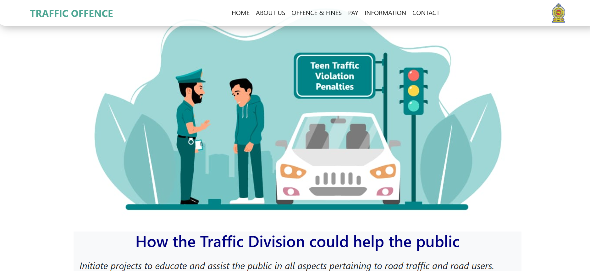
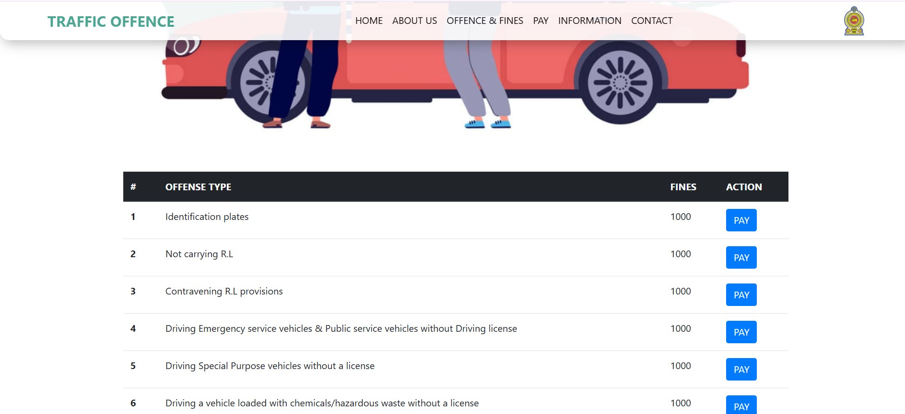
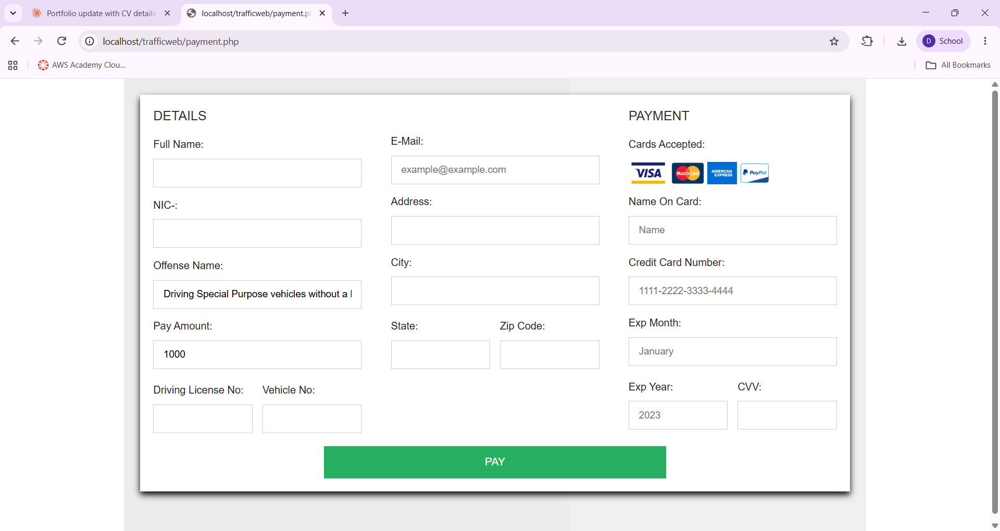
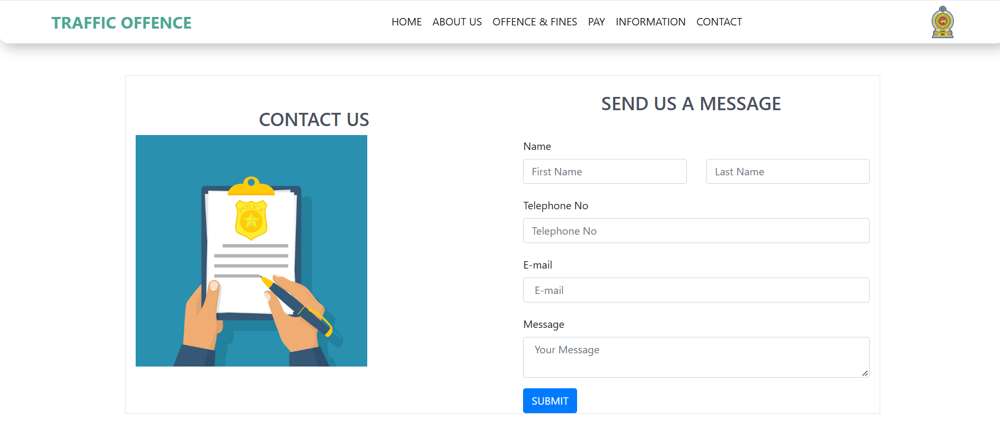

# Traffic Offence & Fine Payment System

A PHP + MySQL web application where citizens can browse traffic offences and their fines, read road-sign / hand-signal information, contact the traffic division and pay fines online, with a downloadable PDF receipt (FPDF).

> Academic project. The payment flow is a **demo only** – do not enter real card details.

## Screenshots
| Home | Offences & fines |
|---|---|
|  |  |
| **Pay** | **Contact** |
|  |  |

## Tech
PHP, MySQL (mysqli), Bootstrap, Font Awesome, FPDF

## Run locally
1. Install XAMPP / WAMP and copy this folder into `htdocs`.
2. Create a MySQL database named `traffic` with the tables `offense_fines`, `pay` and `contact`.
3. Update the credentials in `connect.php` if needed.
4. Open `http://localhost/traffic-fine-system/home.php`.
